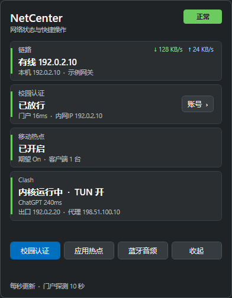
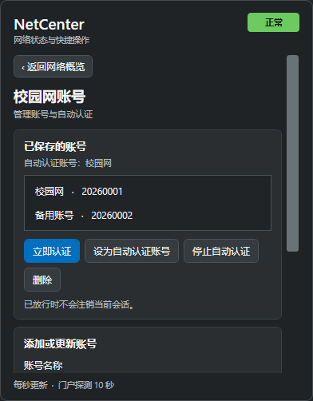

# SCTU-NetCenter

面向 Windows 的托盘网络状态与校园网认证工具。项目基于**四川旅游学院校园网环境**开发，整合网络状态查看、校园网多账号管理和现有的自动认证流程。

> **适用范围：**当前配置和认证逻辑针对四川旅游学院的实际网络环境。原有认证脚本按锐捷 RG-SAM+ / ePortal 风格接口编写，但这不代表所有使用锐捷产品或相同名称认证系统的学校都兼容。不同学校的门户地址、认证流程、参数、服务名称和密码处理方式可能不同；其他校园网尚未验证。
>
> **当前版本不会自动识别认证页面或自动适配其他校园网。**如需在其他环境使用，必须先核对并修改配置及必要代码。请勿将不可信的认证页面当作学校门户输入账号密码。

## 界面预览

| 网络概览 | 校园网账号 |
|:--:|:--:|
|  |  |

图片来自离线虚拟机，地址、账号和状态均为示例，不是真实校园网数据。

## 功能

- 托盘图标与小弹窗：查看链路、网速、门户状态、移动热点、Clash 和出口信息；点击外部窗口收起。
- 校园网账号二级页面：添加、更新、删除多套账号，选择自动认证账号，或停止使用默认账号自动认证。
- 校园认证：沿用现有 ePortal 认证脚本；已放行的连接不会因选择其他默认账号而自动注销。
- 移动热点：可查看状态并手动应用配套策略；辅助配置默认关闭策略，需自行确认后启用。
- 蓝牙音频：发行包内置 BluetoothAudioReceiver；打开“蓝牙音频”，选择已配对的手机等设备，将其音频播放到电脑。支持在接收器设置中配置自动重连和输出设备。
- 其他快捷操作：认证日志、清理旧缓存。

账号密码通过 Windows 当前用户的 DPAPI 加密保存在 `%USERPROFILE%\.netcenter-next\accounts.json`。这保护本地保存的密码，**不改变校园门户本身的传输方式**；当前学校配置使用 HTTP，应在了解对应网络及认证方式后使用。不要提交账号库、门户缓存、日志或真实凭据。

## 使用前须知

这是公开开发快照，尚未完成通用安装与跨学校适配。当前代码仍包含原开发环境的固定目录与校园网参数，请先确认：

1. Windows 10 2004 或 Windows 11、Windows PowerShell 5.1、.NET 8 SDK（从源码构建）和 Python 3.11。蓝牙音频需要支持 A2DP 的蓝牙适配器和已配对设备。
2. 程序默认从 `%LOCALAPPDATA%\Programs\Python\Python311\python.exe` 启动 Python，且该解释器需要 `pywin32`。其他 Python 安装位置需要调整 `app/MainWindow.xaml.cs`。
3. 原有配套目录约定为 `E:\CampusAuth`、`E:\MobileHotspotKeeper`、`E:\NetCenter\tools` 和 `E:\NetCenter\assets`。没有 `E:` 盘或需要自定义位置时，必须同时检查 `src/config.json`、`src/backend.py`、`src/collector.ps1`、`src/clear_hotspot_override.ps1` 和 `app/MainWindow.xaml.cs` 中的相关路径。
4. `src/config.json` 中的校园门户和网段是当前学校环境的配置示例。请先核对本校真实参数；相同 ePortal 名称不意味着认证接口、登录参数和密码方式一致。
5. `tools/Install-AutoAuth.ps1` 与 `tools/Install-Tray.ps1` 是原开发机的迁移/回滚工具，包含固定路径及计划任务假设；**不要在其他电脑上未经检查直接运行**。当前版本不提供通用的一键安装或开机自启动配置。

### 新环境准备

以下步骤只适用于确认使用上述 `E:` 固定目录的全新环境。若对应目录已存在，请先自行检查并备份，**不要覆盖已有配置或认证数据**。安装 Python 时选用每用户安装方式，确认其路径与上面的默认路径一致，然后安装依赖：

```powershell
py -3.11 -m pip install --user -r requirements.txt
```

仓库提供一个仅在目标目录不存在时才复制文件的辅助脚本。它不创建计划任务、不导入已有账号；热点策略示例默认关闭：

```powershell
powershell -NoProfile -ExecutionPolicy Bypass -File .\tools\Prepare-Dependencies.ps1
```

脚本将认证脚本与无凭据的示例配置放入 `E:\CampusAuth`，并准备热点、托盘图标和辅助工具。如果任何目标目录已存在，脚本会中止，需人工处理。下载发行包并解压后，可从解压目录运行 `app\NetCenter.exe`。从源码构建完整发行目录时，请选择一个**不存在的输出目录**：

```powershell
powershell -NoProfile -ExecutionPolicy Bypass -File .\tools\Build-Release.ps1 -OutputDirectory .\artifacts\release
.\artifacts\release\app\NetCenter.exe
```

构建脚本会将蓝牙接收器发布到 `app\bluetooth`。仅执行 `dotnet publish app\NetCenter.csproj` 不会生成蓝牙组件。

左键托盘图标打开或收起；点击“校园认证”或认证卡片上的“账号”进入二级页面。添加账号后，只有明确选择“设为自动认证账号”才会由应用使用该账号自动认证。先检查门户、网段和连接状态，再启用自动认证。

使用蓝牙音频时，先在 Windows 设置中配对手机，点击托盘面板中的“蓝牙音频”，然后在接收器中选择设备并连接。可在接收器设置中将语言切换为中文、开启自动重连，并检查输出设备偏好；接收器可能根据设置切换系统默认音频输出。若旧版接收器已经在运行，启动时会先唤起旧实例。

> `support/campus-auth/config.example.json` 的账号和密码字段为空，应用内管理的校园网密码保存在 DPAPI 账号库中。不要将真实凭据填进仓库文件。

## 项目结构

```text
app/                       WPF 托盘界面与操作调用
src/                       状态采集、多账号存储与认证桥接
support/campus-auth/       ePortal 认证脚本和无凭据配置示例
support/hotspot/           移动热点策略脚本和配置示例
support/tools/             旧缓存工具
assets/                    托盘图标
vendor/BluetoothAudioReceiver/  随包蓝牙接收器源码及 MIT 许可证
third-party-licenses/      接收器依赖的许可证与声明
tests/                     单元、集成与 Windows UI 自动化测试
tools/                     辅助文件准备及原开发环境迁移工具
docs/images/               虚拟机内的模拟数据截图
```

## 验证和已知限制

- 校园认证协议已使用模拟响应覆盖校外、已放行、未认证及过渡状态；账号数据和密码加密有隔离测试。
- 在无网卡 Windows 虚拟机中验证过账号页面、失焦收起、弹窗动效和页面切换。测试使用模拟门户与临时账号。
- 真实断线后自动重登、实际账号切换，以及热点和蓝牙状态切换尚未完成全面实机验收。
- 不同电脑的电源、网卡、Clash、热点配置及认证服务可能导致结果不同。公网出口与 ChatGPT 探测也依赖当前网络及分流规则。
- 自动发现认证网页、多学校配置管理、可移植路径和通用安装器尚未实现；欢迎后续改进。

锐捷官方资料也区分不同代的 Web 认证方案，具体流程依部署而定：[锐捷 Web 认证配置说明](https://www.ruijie.com.cn/fw/wt/32798/)。

## 构建和测试

```powershell
dotnet build .\app\NetCenter.csproj
# 需先发布测试版本，并将 NETCENTER_TEST_EXE 指向其 NetCenter.exe
$env:NETCENTER_TEST_EXE = (Resolve-Path .\artifacts\release\app\NetCenter.exe).Path
python -m unittest discover -s tests -v
```

部分测试启动 Windows 窗口、读取本机网络状态或检查原开发机的计划任务；应在隔离的 Windows 测试环境运行，不应将结果等同于真实校园网验收。测试不应使用真实校园网凭据。贡献和问题反馈请参见 [CONTRIBUTING.md](CONTRIBUTING.md)；安全问题请参见 [SECURITY.md](SECURITY.md)。

蓝牙接收器基于 Noxy229 的 MIT 许可项目，并包含 Dream-yd 分支的修改；署名和依赖许可见 [THIRD_PARTY_NOTICES.md](THIRD_PARTY_NOTICES.md)。本仓库其余部分当前尚未指定开源许可证；如需在许可证范围外复用，请先联系项目维护者。
